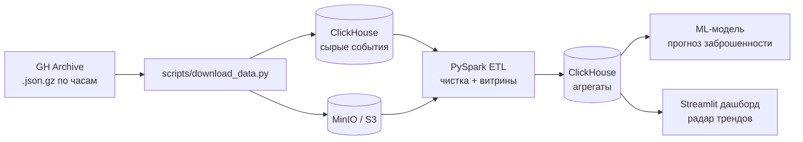

# IT-тренды по открытым логам GitHub (GH Archive)

Big Data проект: анализируем все публичные события GitHub (коммиты, звёзды, форки, PR) из [GH Archive](https://www.gharchive.org/) и строим «радар IT-трендов» — какие языки и библиотеки растут, какие репозитории набирают популярность, когда разработчики активнее всего.

## Архитектура



## Стек

| Слой | Технология |
|---|---|
| Хранилище сырых данных | MinIO (S3) + ClickHouse |
| Обработка | Apache Spark (PySpark) |
| ML | Python, scikit-learn / CatBoost |
| Визуализация | Streamlit |
| Инфраструктура | Docker Compose |

## Быстрый старт

Нужны: Docker Desktop и Python 3.10+.

Если нету:
```
Docker Desktop: https://www.docker.com/products/docker-desktop/
Python 3.10+: winget install --id Python.Python.3.12 -e
```
Если установлено:
```bash
# 1. Склонировать репозиторий
git clone https://github.com/AnGeJloV/gh-trends.git
cd gh-trends

# 2. (опционально) задать период скачивания данных
cp .env.example .env   # и поправить DOWNLOAD_FROM / DOWNLOAD_TO в .env

# 3. Поднять инфраструктуру и загрузить данные:
docker compose up -d --build
# ClickHouse + MinIO + одноразовый loader (скачает по .env и загрузит данные).
# Первый запуск качает образы ~2 ГБ, дальше — быстрее.
# Следить за ходом: docker compose logs -f loader

# 4. Полный пересчёт — Spark-ETL (витрины) и ML-модель (когда данные за >= 3 недели):
docker compose --profile pipeline up -d --build
# Тяжёлая операция (на полном периоде ~25 мин ETL + ~10 мин ML), поэтому
# запускается ЯВНО и НЕ запускается при каждом `docker compose up -d`.
# Следить за ходом: docker compose logs -f spark-etl (потом ml-trainer)
```

После прогона: ClickHouse на <http://localhost:8123/play>, консоль MinIO на <http://localhost:9001>.

**Период скачивания** задаётся в `.env` (см. `.env.example`), код трогать не нужно:
- по умолчанию — 3 дневных часа с 2026-09-20 (~50 МБ, быстрый прогон);
- для полного периода проекта (нужен для ML!): `DOWNLOAD_FROM=2026-09-01` и `DOWNLOAD_TO=2026-09-30` — это гигабайты и часы скачивания;
- данные лежат в `./data` и не качаются повторно — можно увеличивать период и перезапускать;
- **после успешной загрузки локальные копии в `data/raw` можно удалять** (17+ ГБ за месяц) — всё уже в MinIO, а loader сверяется с ClickHouse и не перекачает загруженное.

**Догрузка данных и пересчёт витрин.** Витрины (`mart_*`, `events_parsed`) и ML-прогнозы отражают состояние на момент последнего прогона цепочки. Если расширили период в `.env` — просто перезапустите:
```bash
docker compose up -d loader                     # докачает и догрузит только разницу
docker compose --profile pipeline up -d         # spark-etl и ml-trainer пересчитаются по новым данным
```
Spark-ETL пересчитывает таблицы с нуля (TRUNCATE + запись), поэтому дублей не будет — можно перезапускать сколько угодно раз.

**Сколько данных нужно.** Для витрин и дашборда хватит любого объёма (хоть 3 часа). Для обучения ML нужна история **>= ~3 недель** (окно наблюдения 14 дней + окно исхода 7 дней, см. `ml/config.py`) — иначе `ml-trainer` завершится с ошибкой «данных слишком мало», на остальном это не скажется.

<details><summary><b>Ручной запуск по шагам</b> (для отладки, без Docker-оркестрации)</summary>

```bash
docker compose up -d clickhouse minio minio-init   # только инфраструктура
pip install -r requirements.txt

python scripts/download_data.py                    # 3 дневных часа с 2026-09-20
python scripts/download_data.py --hours 24 --hour 0   # сутки
python scripts/download_data.py --from 2026-09-01 --to 2026-09-15   # период

python scripts/init_db.py    # создать таблицы витрин в ClickHouse
python scripts/load_raw.py   # в MinIO (бакет raw) и ClickHouse (gh.events_raw)
# Повторный запуск пропускает уже загруженные файлы — можно докачивать и догружать.

docker compose up --build spark-etl    # ETL: чистка + 3 витрины

pip install -r ml/requirements.txt
python ml/train.py                     # ML: прогноз заброшенности репо
```
</details>

Проверить, что ClickHouse поднялся: открыть <http://localhost:8123> — должно быть `Ok.`
Веб-клиент для SQL-запросов: <http://localhost:8123/play> логин `default`, пароль `clickhouse` (см. `docker-compose.yml`).

Запросы для проверки ClickHouse:

- `SHOW TABLES FROM gh;`
- `SELECT count() FROM gh.events_raw;`

Консоль MinIO: <http://localhost:9001> (логин/пароль `minioadmin`/`minioadmin`, иначе — см. `docker-compose.yml`).

## Команда и зоны ответственности

| Кто | Роль | Папка | За что отвечает |
|---|---|---|---|
| Человек 1 | Data Engineer / DevOps | корень + `scripts/` | docker-compose, скачивание, загрузка данных в MinIO и ClickHouse |
| Человек 2 | Spark-разработчик | `etl/` | парсинг JSON, чистка, агрегаты (витрины) |
| Человек 3 | Data Scientist | `ml/` | модель прогноза заброшенности репо, метрики |
| Человек 4 | BI / презентатор | `dashboard/` | Streamlit-дашборд, записка, презентация |

## Как работать в репозитории

1. Каждый работает **только в своей папке** (см. таблицу выше) — так вы не помешаете друг другу.
2. Работаем без ревью: пушим прямо в `main`, у всех равный доступ. Перед пушем всегда сначала `git pull`. После завершения работы сразу `git push` — не держим локальные изменения дольше дня.
3. Данные (`data/`, `*.json.gz`) в git **не коммитим** — качаем скриптом.
4. Задачи и план — в [docs/TASKS.md](docs/TASKS.md). Сделал задачу — поставь `[x]` и допиши строку в журнал.
5. ETL (Человек 2) и ML (Человек 3) идут сервисами `spark-etl` и `ml-trainer` в профиле `pipeline`: полный пересчёт — `docker compose --profile pipeline up -d`. Повседневная работа (дашборд, SQL) — просто `docker compose up -d`, тяжёлые сервисы при этом не перезапускаются. Подробности по ML — в [ml/README.md](ml/README.md), самотест без реальных данных: `python ml/train.py --smoke`.

6. Повторный прогон ETL безопасен: `etl/writer.py` пишет в ClickHouse в режиме `overwrite` с TRUNCATE — таблицы пересчитываются с нуля, дублей нет. Не менять на `append` без необходимости.

7. Дашборд (Человек 4): пока в разработке. Когда появятся `dashboard/app.py` и `dashboard/Dockerfile` — убрать `profiles: ["dashboard"]` у сервиса dashboard в `docker-compose.yml`, и дашборд станет частью общего `docker compose up -d` (<http://localhost:8501>).
